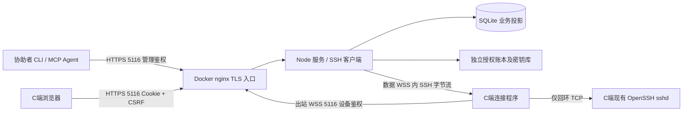

# NyaaRink V1 设计审计

日期：2026-10-22。审计者：当前对话模型。用户已明确本项目不跨模型操作，覆盖通用开发指南 §12 的模型分工要求。

状态：2026-10-22 用户已整体批准 R01–R08 及其引用标准，设计基线已冻结。没有开始 P 阶段，没有提交、推送或部署。计划唯一入口为《开发计划-SSOT.md》。

## 1. 结论

方案可行，但浏览器只能承担知情授权和状态展示。修改本地 SSH 授权、保持出站隧道、登录后恢复和本地紧急撤销，必须由 C端本地连接程序承担。访问网页本身不能自动授予操作系统权限。

已批准采用单实例 TypeScript 服务、独立 C端连接程序、HTTPS/WSS 单公网端口、每条 SSH 独立 WSS 数据连接。SSH 私钥始终属于 S端；C端仅安装本次公钥和持有自己的设备凭据。S端执行 SSH，远端 CLI/MCP 只获得执行结果和交互通道。

授权与在线状态分离：断网、超时、进程退出、注销、重启均只影响在线状态；只有明确的主动断开命令触发授权撤销。用户已确认 C端在用户登录后自动恢复，不要求未登录即上线。

## 2. 本轮已确认的增量

| 事项 | 用户决定 |
| --- | --- |
| 执行模型 | 当前对话模型负责审计、计划与开发，不跨模型 |
| 公网端口 | 改为 HTTPS/WSS **5116**，保留现有 5115 服务 |
| C端自动恢复 | V1 包含用户登录后自动恢复 |
| 数据库恢复 | 保留有效授权；最新权威账本缺失或完整性不明时冻结访问，不销毁授权 |
| 操作能力 | 命令执行、交互终端、受限 SFTP、S端容器内原生 OpenSSH 配置 |
| 私钥边界 | 不给远端 Agent 返回 SSH 私钥 |
| 日志 | 默认不保存命令正文及输出，只保存操作元数据、撤销记录和字节指标 |

旧文档的 5115 需求由以上决定覆盖，不能再据旧示例开端口。未同意恢复备份时自动撤销全部授权。

## 3. 架构与信任边界

- S端为 macmini 服务宿主机；CLI/Agent 所在机器可以不同，返回路径必须注明属于哪一端。
- 公网只发布 nginx 的 5116。Node 和控制 socket 位于容器网络/私有目录，不发布 SSH 中继监听。
- 浏览器会话、设备身份、引导 Key、S管理 Key 四类凭据互不替代。
- 管理 Key 能访问所有本服务授权的 C端，属于高权限秘密；多租户、细粒度团队 RBAC 不属于 V1。
- HTTPS 保护链路，不能阻止恶意 S端在已授权账户内执行破坏性命令。C端需信任协助者；普通账户也是实质访问权。

## 4. 风险及控制

| 风险 | 设计控制 | 验收依据 |
| --- | --- | --- |
| 预览误消费、双击或并发争抢 | 接受 POST 原子消费，接受请求幂等，GET 不消费 | 同邀请码并发仅一个浏览器成功 |
| 超时误撤销 | 授权状态和连接状态分开；超时仅关连接或任务 | 断网/关闭页面/重启后旧授权可恢复 |
| 撤销与重连竞态 | 持久化撤销先行；通道世代隔离；每次开流复核 | 撤销后延迟回包、旧脚本和旧票据均无效 |
| 旧备份复活权限 | 独立最新权威账本重建数据库；禁止回退账本 | 恢复旧 DB，已撤销仍撤销、有效仍有效 |
| C端离线无法清理 | S立即拒绝访问，清理标记 pending；C恢复后补清理 | 不把待清理描述为清理完成 |
| 隧道变任意内网代理 | C只连接已登记的本机回环 sshd；不接收远端任意目标 | 请求其他地址/端口被拒绝 |
| 主机身份被替换 | 本地确认并固定 sshd 主机公钥；S严格核验 | 主机公钥变更后冻结该连接并要求 C确认 |
| 公钥删除但现有 SSH 未断 | 跟踪并关闭全部关联 WSS/TCP/SSH channel | 双向撤销后已建立交互终端也结束 |
| 重复登录和旧实例上线 | 每设备一个控制租约、连接世代；新实例接管关旧流 | 并发设备控制连接不会串流 |
| Windows 提权混淆 | 安装提权和远程账户分别确认；管理员账户单独路径 | 普通安装不能静默授权管理员 |
| 下载包被替换 | 固定清单、哈希及离线发布签名，HTTPS 分发 | 篡改、降级、跨平台包均拒绝 |
| 开源泄漏 | 双重 ignore、扫描与构建上下文检查 | 仓库、镜像、日志均无真实配置和凭据 |
| 磁盘满/账本损坏 | 控制面拒绝成功响应、冻结访问，保留待恢复状态 | 不以旧 DB 继续授予权限 |

## 5. 参考项目对标与偏差

- NyaaFrame：保留 React、TS strict、Tailwind、npm、V/P、版本单源、运行时签名和 Python 自动化。旧指南的 Node20 已结束官方维护，不直接沿用。
- NyaaQiny-MCP/NyaaChat-MCP：复用工具注册、结构化错误、Bearer 管理鉴权组织方式。拒绝“没有 API Key 即匿名”的旧模式；不直接继承遗留 SSE 双传输。
- macmini LE 参考：宿主 acme.sh + DNS-01，证书目录只读挂载、合并续期 reload hook。真实域名、DNS 凭据、证书路径和仓库地址不复制到公开文档。
- 项目开发 skill 由工作空间提供；产品功能就绪后再交付面向使用者的 `.agents/skills`，不在项目复建开发技能。

## 6. 技术调查与可验证事实

2026-10-22 已通过 SSH 只读核实目标为 Linux x86_64、Ubuntu 24.04、Docker 29.8，宿主 acme.sh 目录存在。5115 为已有容器占用，5116–5119 未发现 TCP 监听或 Docker 映射。**未验证**路由器映射、DNS 指向、实际证书 SAN/到期、5116 外网可达性或对外吞吐。部署阶段必须重新检查，当前查询不构成端口预留。

已通过 Context7 查询 Node24 分发、ssh2 `hostVerifier`/`sock`、ws Duplex 背压和 MCP v1.x 无状态 Streamable HTTP。通过官方 npm 元数据及 Node Release 仓库核查版本，事实与链接见《技术依据与版本基线.md》。查询成功不等于依赖组合已构建验证。

## 7. 安全与开源合规边界

这是经 C端主动授权的远程协助服务，须保持可见授权、明确目标账户、显式撤销、可恢复的本地控制与最小默认权限。产品不提供隐蔽安装、不提供跳过确认的管理员授权、不假称能撤回已读取数据。

网页必须告知 AI Agent 可能参与、断网不撤权、登录后会自动恢复、本次新增公钥与自启动项的用途、审计保存范围、S离线时撤销状态。默认不记录命令正文不等于系统 sshd 或目标 shell 不留日志。

保留 AGPL-3.0 LICENSE 原文，页面 About 提供对应版本源代码入口；发行包附第三方许可证和软件清单。实际部署的修改版本按许可证履行网络使用者源代码获取义务。这里是技术与发布合规设计，不声称覆盖所有司法辖区或企业场景的法律要求。

## 8. 开发准入

R01–R08 已获用户整体批准；下一步单独提出 P1 Plan，获批后才能实现。操作系统验收、协议故障注入、安全恢复测试及四个 MCP 客户端实测是上线闸门；未通过不能用“开发时临时降级”替代。禁止当前阶段提交、推送和启动项目容器。
